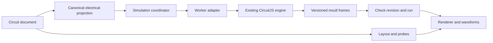

# Editor / worker protocol

Design and implementation contract, 2026-11-13. Versioned requests, result gating
and candidate replacement/reset are implemented for divider circuits; see
[COORDINATOR.md](COORDINATOR.md) for current APIs and limits. Continuous run/pause
and RC switch operations are implemented in [RUN-AND-LIVE-EDITS.md](RUN-AND-LIVE-EDITS.md).
The earlier text/index worker and
first document API are retained separately for regression coverage.

Read [the document design](EDITOR-DESIGN.md) first. A concrete runtime trace is in
[worker-session.json](examples/worker-session.json).



## Identities and revisions

| Field | Meaning |
| --- | --- |
| protocolVersion | Message contract version, initially 1; separate from saved schemaVersion. |
| sessionId | Unique worker incarnation, allocated by the coordinator during initialization. Never reused. |
| documentId | Saved document identity. |
| documentRevision | Coordinator's monotonic committed-edit counter, including layout edits. Not saved and not required on frames. |
| circuitRevision | Coordinator's monotonic electrical-document version; worker acceptance is tracked separately. An undo is a new revision. |
| runEpoch | Monotonic run identity for that open document; changes on initial install, reset/replacement or recovery, not pause/resume or supported live switching. |
| requestId | Monotonic positive integer within a worker session. Never reused or automatically retried. |
| frameSequence | Monotonic result sequence within one run epoch; starts at 1 after first successful step. |

The coordinator tracks both the desired circuit revision and the worker's accepted
revision. An edit may be visible while its simulation update is pending. Do not
mislabel old solver state as results for that new document.

Revisions are session bookkeeping, not values restored from an old save file.
Reopening a file establishes a fresh session. The coordinator keeps run epochs
monotonic across worker replacements while that document remains open.

## Messages

Use JSON-compatible objects initially, with SI-valued finite numbers and stable
IDs. The first `initialize` request negotiates protocol version, assigns sessionId,
and returns capabilities (models, integration modes, supported live changes and
step limits). Before initial installation, state is documentId=null, revision=0,
epoch=0. Advertised live-change capabilities must be limited to tested support.

Every subsequent request has this shape:

```text
{
  protocolVersion: 1, sessionId, requestId,
  operation,
  base: {documentId, circuitRevision, runEpoch},
  target?: {documentId, circuitRevision, runEpoch},
  payload: {...}
}
```

`base` must exactly match the addressed worker's accepted state. A mismatch returns
`STALE_BASE` before invoking the engine. A request with an already-seen or older
requestId returns `DUPLICATE_REQUEST` without executing again, even if the earlier
request failed. A timeout terminates the session; no automatic mutation retries.
This keeps the first implementation free of ambiguous partial retries.

| Operation | Payload | Effect |
| --- | --- | --- |
| installCircuit | Complete canonical electrical projection | Initial load into a fresh worker; adopt positive target revision/epoch after successful validation/load. |
| step | count, within negotiated limit; optional channels | Advance exactly count successful steps; return frame, plus aligned per-step samples if requested. Does not change revision/epoch. |
| setSwitch | componentId, closed, statePolicy=preserve | Resolve ID, validate live-change capability; apply at step boundary. Target revision advances; epoch/time retained. |
| reset | statePolicy=reset | Restore latest accepted circuit's initial conditions and switch parameters; same revision, new epoch, time zero. |
| snapshot | none | Return last completed frame or `NO_FRAME`; do not invent solved results at time zero. |
| dispose | none | End session; coordinator can also terminate worker directly. |

Initial installation can adopt any positive target revision/epoch chosen by the
coordinator, so a fresh replacement worker can take over revision 8 rather than
renumbering the document. Subsequent switch changes require target revision greater
than base revision and the same epoch. Reset requires the same circuit revision
and an increased epoch. No operation may silently downgrade preserve to reset.

`installCircuit` receives the projection from EDITOR-DESIGN: sorted typed devices
with public pin-to-net mappings, deterministic net keys/ground status and simulation
settings. It receives no layout, user wire routes, selections or display labels.
The worker validates it again and owns the generated CircuitJS input/index mapping.
Returned ID mappings therefore cannot drift from the engine instance they describe.

Commands that affect simulation are ordered between bounded step calls. A switch
acknowledgement includes `appliedAtTime` and the new accepted revision. The next
frame is generated by an actual successful step. Analysis/restamping snapshots
must not be advertised as a fully solved frame at the unchanged time.

## Replies and results

Replies echo protocolVersion, sessionId and requestId and include either:

```text
ok: true,
state: {documentId, circuitRevision, runEpoch},
result: acknowledgement | SimulationFrame
```

or:

```text
ok: false,
state: {documentId, circuitRevision, runEpoch},
error: {code, message, disposition: unchanged | faulted, diagnostics: Diagnostic[]}
```

Initial error codes: INVALID_DOCUMENT, UNSUPPORTED_MODEL, UNSUPPORTED_LIVE_CHANGE,
STALE_BASE, DUPLICATE_REQUEST, INVALID_OPERATION, NO_FRAME and ENGINE_FAILURE.
Diagnostics carry severity, a readable explanation and component/pin references
where known. Surface solver regularization/stabilization warnings without leaking
synthetic coordinates into the main error message.

```text
SimulationFrame {
  documentId, circuitRevision, runEpoch, frameSequence,
  time, timeStep,
  pinVoltages: Map<ComponentId, Map<PinId, number>>,
  componentCurrents: Map<ComponentId, number>,
  diagnostics: Diagnostic[]
}
```

The frame travels inside its session-stamped reply. Current directions are those
in EDITOR-DESIGN, not raw engine post order. Omit unavailable currents (for example
ground); do not use zero as an unknown value. Do not emit NaN/Infinity as results.
Send one batch per requested step block, not a message per component or internal
time step. Requested waveform samples can later use transferable typed arrays,
with the same identity/revision/epoch envelope; JSON frames suffice for this slice.

## Results may be stale

For the live display, accept a frame only when:

1. Its session is the active worker and documentId is the open document.
2. Its circuitRevision equals the desired and accepted circuit revision.
3. Its runEpoch is the active epoch and frameSequence is newer than the last displayed.

Layout-only edits advance documentRevision but not circuitRevision, so live results
remain usable during dragging. Electrical edits invalidate the old live overlay
immediately; display a pending/error state until matching results arrive. A delayed
frame from an old run cannot recolour a new circuit even if their IDs overlap.

Waveform buffers have a run epoch. Reset/replacement starts a new buffer/segment.
A supported switch event keeps time and adds a revision/event marker. With the
initial one-in-flight scheduling rule, drain the previous step before applying
that event; never interpolate across dropped samples or an epoch boundary.
Probe additions read existing pin currents/voltages without changing the circuit
revision; deleted probe targets produce a visible invalid-probe diagnostic.

## Scheduling and replacement

The main-thread coordinator implements run/pause by requesting bounded step blocks.
Keep at most one step request in flight, then allow pending mutations before the
next block. Adapt block size to measured latency later. Do not enqueue a long chain
of steps, which would put edits and pause behind that backlog.

Pause means stop issuing steps and await the in-flight block. It cannot interrupt
a running synchronous solve. Display `pausing` until acknowledgement if necessary.
Coalesce layout previews locally. Coalesce undispatched full replacements to the
newest committed document, but preserve the order of live switch events. If a
replacement is already required, include subsequent switch values in that new
installation and show the existing restart-pending state.

For general electrical edits, initially replace the engine in a candidate worker:

1. Pause/drain the active worker. Keep its last accepted state available.
2. Validate/compile the desired projection and allocate a new session/new epoch.
3. Start at most one candidate worker and install into it.
4. Activate it only if load succeeded and its target is still the desired revision.
5. Dispose the old worker after activation. Discard obsolete candidates.

This makes failed replacement recoverable without claiming the current singleton
engine supports rollback or two staged circuits in one realm. Invalid candidate
input leaves the old worker paused. Keep the user's edited document and show its
diagnostics; old results can remain as explicitly historical data, not a live overlay.
Fixing the document or undoing the edit can initiate a new valid installation.

For in-place switch changes, validation failures return disposition=unchanged.
If analysis fails after touching engine state, return ENGINE_FAILURE/faulted and
stop accepting steps. Do not claim rollback. Recovery installs the desired circuit
in a new worker and resets time with a visible restart status. Crashes, startup
errors, message decoding errors and request deadlines follow the same recovery path.

Reset also needs care: the prototype's reset reloads its original imported text.
The document adapter must instead reset the latest accepted circuit, including any
live switch parameter changes. Reinstallation into a candidate worker is an
acceptable first implementation of this reset contract.

## Implementation order

1. Document/catalog validation, graph compilation and private index/post mapping.
2. ID-mapped frames for the divider, including source current sign tests.
3. Coordinator revisions/epochs, layout-only no-ops and stale-frame rejection.
4. Candidate replacement/reset with explicit fault handling.
5. Supported switch transactions and bounded run/pause scheduling.

Retain the original six numerical fixtures throughout. Add adapter tests that
exercise behaviour rather than repeat serialization details: equivalent layouts,
explicit crossings, reordered components, stale/duplicate requests, rejected
candidate activation, capacitor continuity during switching, and undo/reset rules.


## Implemented oscilloscope sample batches

Step accepts optional `channels`, at most 32 descriptors of the form:

```json
{"id":"Vin","positive":{"componentId":"vin","pinId":"p"},"negative":null}
```

A negative terminal object gives a differential reading; null means implicit ground.
Every descriptor and pin is validated before any engine mutation. Duplicate IDs,
unknown pins and malformed descriptors fail without advancing the worker. Channels
are canonically ordered by ID. No channels preserves the previous bounded-step API.
Initialize now advertises perStepSamples and maxSampleChannels.

A sampled result has `sampleBatch: {channels, times, values}`. `values[id]` and times
have exactly count aligned entries, one per successful electrical step; values are
volts and times seconds at the legacy solve timestamp (frame.time minus timestep).
The final ordinary frame still describes the last completed result. Snapshot does
not replay sample batches. Worker transport stays one reply per bounded request.

The coordinator's setSampleChannels method stores descriptors separately from the
circuit projection. Each request snapshots them at dispatch, and its usual run/
revision/epoch/sequence gates apply to the whole reply. Display buffers additionally
match the expected accepted identity and channel targets, rejecting old probes or
runs even if their IDs/labels overlap. Labels/layout never become solver identity.
